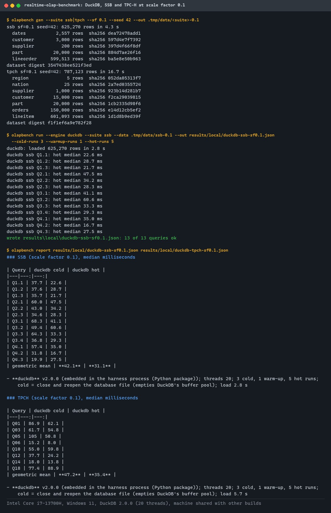
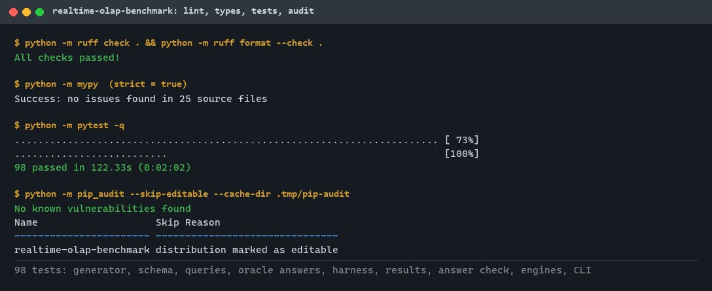
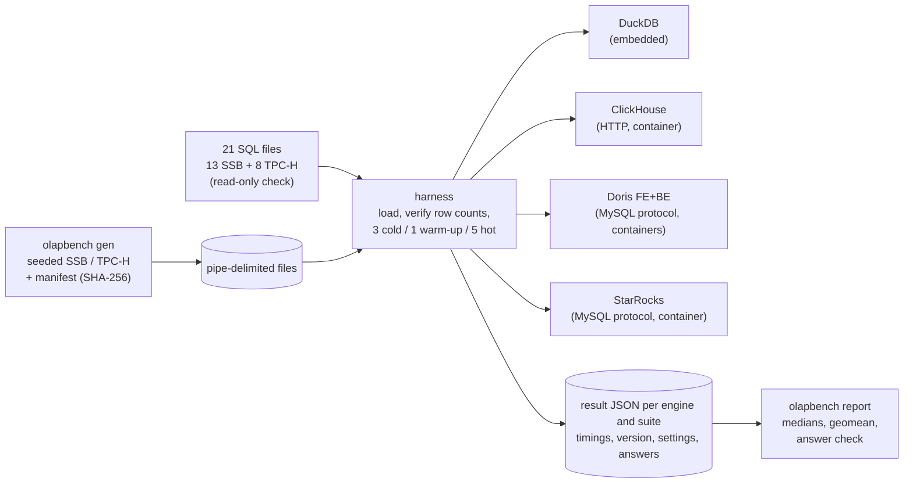
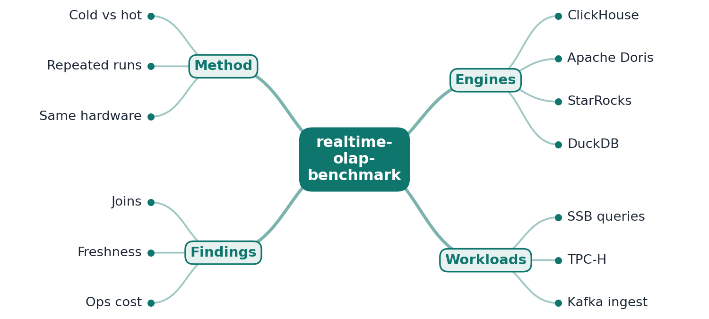

# realtime-olap-benchmark

[](https://github.com/EquinoxWN/realtime-olap-benchmark/actions/workflows/ci.yml)


> Seeded Star Schema Benchmark and TPC-H data and SQL, each query timed cold and hot several times on DuckDB, with medians, spread, versions, settings and answer checks. Adapters and a digest-pinned Docker CI job for ClickHouse, Apache Doris and StarRocks are written; their first CI run is pending.

Part of my **Data Engineering** list · SQL · Python

## Proof it works

`olapbench` generated SSB and TPC-H at scale factor 0.1 (625,270 and 787,123 rows), loaded them
into DuckDB, checked every table's row count against the manifest, and ran all 21 queries 3 times
cold, once to warm up and 5 times hot. Hot geometric means: 31.1 ms (SSB) and 35.4 ms (TPC-H) with
DuckDB's default 20 threads on a laptop shared with other builds:



98 tests pass locally, including plain-Python recomputation of eight query answers; ruff,
`mypy --strict` and `pip-audit` are clean:



ClickHouse, Doris and StarRocks run only in the CI `engines` job (Docker is not used on the
development machine); that job has not run yet, so there are no server numbers yet. See
[Tests and results](#tests-and-results).

## Architecture

**What M1 runs today:**



**Full roadmap (M1 to M3):**



## How it works

_Step 2 is built and measured on DuckDB (M1). For step 1, the ClickHouse, Doris and StarRocks adapters, compose file and CI job are written, but the first CI run is pending. The rest is on the [roadmap](#roadmap)._

1. All four engines run in Docker on one machine, with versions and settings documented.
2. Star Schema Benchmark and TPC-H queries run cold and hot, several times each, reporting medians.
3. A Kafka stream measures real-time ingestion: rows per second and how fresh query results are.
4. Join-heavy and single-table aggregation queries are reported separately, since engines differ most there.
5. Table design (sort keys, partitions, materialized views) is tuned per engine, and every tuning is documented.
6. Findings cover speed, freshness and operating cost, with no single 'winner'.

In M1 a run goes like this:

- `olapbench gen` writes each table as a pipe-delimited file and records row counts and SHA-256
  digests in `manifest.json`. Same seed and scale, same bytes, on every machine.
- `olapbench run` refuses data whose digest changed, recreates the tables (one logical schema
  rendered as DDL per engine, no tuning), loads them, and checks each table's `count(*)`.
- For each query: N cold runs, each after the engine's cache reset (and, with `--drop-os-cache`
  on Linux, the page cache); one untimed warm-up; M hot runs. Client wall-clock time includes
  fetching the result. Every run must return the same rows; a failure is recorded, not fatal.
- `olapbench report` prints per-query cold and hot medians, the geometric mean, each engine's
  version, threads and cold method, and compares every answer with the first engine's.

DuckDB is embedded in the harness process (it has no server); the other three are servers in
containers, started one at a time by `scripts/bench_servers.sh` so they never share the CPU.

## Who it helps

- **Who:** Data and platform engineers shortlisting an analytics database for dashboards.
- **The problem:** Published comparisons use different data, hardware and settings, are often
  hot-cache only, and rarely show that each engine returned the right answer.
- **How to use it:** Generate a dataset at the scale you care about, run `olapbench run` against
  each engine (DuckDB locally, the servers through `make bench-servers` or the CI job), and read
  `olapbench report`: per-query cold and hot medians, spread, versions, settings and the answer
  check, all from the same data and SQL. Add your own queries as SQL files.

## Tech stack

| Area | In M1 | Planned |
|---|---|---|
| Engines | DuckDB 2.0 (embedded, measured); adapters, digest-pinned compose file and CI job for ClickHouse 26.3, Apache Doris 4.1.3, StarRocks 4.1.6 (first CI run pending) | Per-engine tuning: sort keys, partitions, materialized views (M3) |
| Workloads | Star Schema Benchmark (13 queries), TPC-H subset (8 queries), seeded Python generator | Kafka streaming ingest and freshness (M2) |
| Harness | Python CLI `olapbench`: cold / warm-up / hot runs, medians, CV, geomean, answer check, validated JSON results | Join-heavy vs single-table reporting (M2), cost per query (M3) |
| Ops | Digest-pinned images, one engine at a time, GitHub Actions with SHA-pinned actions | - |

Language: **Python** (3.11+) and **SQL**. Code in [`src/realtime_olap_benchmark/`](src/realtime_olap_benchmark): generator, schema, queries, engine adapters, harness, results and report.

## Run it

**Prerequisites:** Python 3.11+. Docker on Linux only for the three server engines.

```bash
python -m venv .venv && source .venv/bin/activate   # Windows: .venv\Scripts\activate
make setup            # install the package and dev tools
make lint             # ruff, ruff format, mypy --strict
make test             # 98 tests
make bench SF=0.1     # SSB and TPC-H on DuckDB, prints the report
```

Step by step, or against a server engine:

```bash
olapbench gen --suite ssb --sf 0.1 --out data/ssb
olapbench queries --suite ssb
olapbench run --engine duckdb --suite ssb --data data/ssb --out results/duckdb-ssb.json \
  --cold-runs 3 --warmup-runs 1 --hot-runs 5 [--threads 4] [--queries Q1.1,Q2.1]
olapbench report results/*.json --strict      # exit 1 if engines disagree

# Linux with Docker: ClickHouse, Doris, StarRocks one at a time, page cache dropped per cold run
export CLICKHOUSE_USER=bench CLICKHOUSE_PASSWORD=$(openssl rand -hex 16)
make bench-servers SF=0.1
```

Connection settings come from the environment: `CLICKHOUSE_URL`, `CLICKHOUSE_USER`,
`CLICKHOUSE_PASSWORD`; `DORIS_HOST`, `DORIS_PORT` (9030); `STARROCKS_HOST`, `STARROCKS_PORT`.

## Tests and results

Full numbers, commands and engine settings: [docs/results/m1.md](docs/results/m1.md).

| Test file | Tests | What it proves |
|---|---:|---|
| `test_datagen.py` | 16 | Same seed, same bytes; sizes scale; SSB and TPC-H value domains; order totals and statuses come from their line items; SHA-256 check catches an edited file |
| `test_schema.py` | 10 | DDL per engine names every column; MergeTree ordering; duplicate-key tables with buckets and one replica |
| `test_queries.py` | 13 | 13 SSB and 8 TPC-H queries ship; writes and multiple statements refused; per-engine overrides |
| `test_oracle.py` | 6 | All 21 queries run; SSB Q1.1-Q1.3, Q2.1 and TPC-H Q1, Q6, Q12, Q14 equal plain-Python recomputation |
| `test_harness.py` | 13 | Cache reset before each cold run; warm-up untimed; failures recorded; changing answers caught; lost rows caught |
| `test_results.py` | 21 | Statistics; result-file round trip; 13 kinds of malformed document rejected |
| `test_answers.py` | 5 | Tolerant numeric comparison; disagreements and different datasets reported |
| `test_engines.py` | 9 | ClickHouse protocol against a fake server (credentials only in headers); Doris/StarRocks loader; DuckDB cold reset |
| `test_cli.py` | 4 | `gen`, `run`, `report --strict` end to end; error exits |
| `test_smoke.py` | 1 | Package version |

| Check | Result |
|---|---|
| Tests (`make test`) | **98 passed**, 0 failed |
| Lint / types / audit | ruff and `mypy --strict` clean; `pip-audit`: no known vulnerabilities |
| DuckDB, SF 0.1, default 20 threads | hot geomean SSB **31.1 ms**, TPC-H **35.4 ms**; cold 42.1 / 47.2 ms; median hot CV 0.20 / 0.21 |
| DuckDB, SF 0.1, `--threads 4` | hot geomean SSB **16.2 ms**, TPC-H **11.4 ms**; median hot CV 0.11 / 0.10 (less thread contention on a shared CPU) |
| ClickHouse, Doris, StarRocks | CI `engines` job written, **not run yet**; no numbers |

The generator follows the SSB and TPC-H schemas and value domains but is not `dbgen`
([ADR 0003](docs/adr/0003-seeded-generator-instead-of-dbgen.md)), so these numbers are not
comparable with official results.

## Roadmap

**M1** (≈8 h)
- [x] Write `docs/rfc/0001-design.md`: problem, goals, non-goals, chosen design
- [ ] All four engines run in Docker on one machine, with versions and settings documented. (DuckDB embedded and measured; for the three servers, the compose file and CI job are written, but the first CI run is pending)
- [x] Star Schema Benchmark and TPC-H queries run cold and hot, several times each, reporting medians.

**M2** (≈8 h)
- [ ] A Kafka stream measures real-time ingestion: rows per second and how fresh query results are.
- [ ] Join-heavy and single-table aggregation queries are reported separately, since engines differ most there.

**M3** (≈9 h)
- [ ] Table design (sort keys, partitions, materialized views) is tuned per engine, and every tuning is documented.
- [ ] Findings cover speed, freshness and operating cost, with no single 'winner'.
- [ ] Publish the proof below with real numbers

## Proof

What this repo must show before it counts as done:

- Result tables with medians and variance, plus a decision guide by workload.

| Result | Value |
|---|---|
| M3 proof above | Not measured yet (M3). Current M1 numbers: see [Tests and results](#tests-and-results). |

## Why it matters

- **Interview angle:** 'Choose an analytics database for real-time dashboards' trade-off discussions.
- **Upstream I'd like to contribute to:** Apache Doris (from Baidu) or StarRocks: benchmark and documentation improvements.

## Design docs

- [RFC 0001: design](docs/rfc/0001-design.md)
- [ADR 0001: record architecture decisions](docs/adr/0001-record-architecture-decisions.md)
- [ADR 0002: load Doris and StarRocks with SQL inserts, not Stream Load](docs/adr/0002-load-with-sql-inserts-not-stream-load.md)
- [ADR 0003: a seeded Python generator instead of dbgen](docs/adr/0003-seeded-generator-instead-of-dbgen.md)
- [M1 results](docs/results/m1.md)

## Scope

This is a learning and portfolio system, not a hosted production service. Everything runs locally
or in CI.

## Security and contributing

- Every GitHub Action is pinned to a commit SHA; workflows run read-only, without persisted credentials.
- Container images are pinned by digest and memory-limited; ClickHouse and StarRocks ports bind to 127.0.0.1; the CI ClickHouse password is random per run and masked.
- Query files must be a single read-only `SELECT`; data files are checked against their SHA-256; result files are schema-validated and size-capped; ClickHouse credentials go in headers, never URLs.
- Dependabot update pull requests are paused (`open-pull-requests-limit: 0`) so the repository keeps a single `main` branch; dependencies are updated by hand and checked by the CI audit.
- Report vulnerabilities privately: see [SECURITY.md](SECURITY.md). To contribute, see [CONTRIBUTING.md](CONTRIBUTING.md).

## License

MIT, see [LICENSE](LICENSE).
